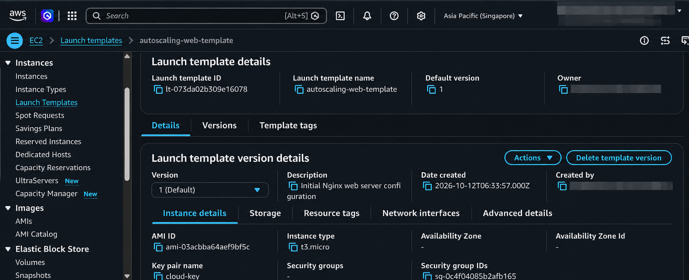

# AWS EC2 Auto Scaling Lab

## Overview

This project demonstrates how to configure an Amazon EC2 Auto Scaling Group to maintain the desired number of instances and automatically replace an instance after termination.

The lab uses a launch template to define the EC2 configuration and an Auto Scaling Group to manage instance capacity.

## Architecture

```text
EC2 Launch Template
        |
        v
Auto Scaling Group
        |
        v
EC2 Instance
        |
        | Instance terminated
        v
Auto Scaling Group detects reduced capacity
        |
        v
Replacement EC2 instance launched
        |
        v
Instance returns to InService
```

## AWS Services Used

- Amazon EC2
- EC2 Launch Templates
- EC2 Auto Scaling
- Amazon VPC
- Availability Zones

## Configuration

| Setting | Value |
|---|---|
| Region | Asia Pacific (Singapore) |
| Operating System | Ubuntu |
| Instance Type | t3.micro |
| Launch Template | autoscaling-web-template |
| Auto Scaling Group | cloud-web-sg |
| Minimum Capacity | 1 |
| Desired Capacity | 1 |
| Maximum Capacity | 1 |
| Network | Default VPC |
| Subnets | Two Availability Zones |

## Implementation

1. Created a launch template using an Ubuntu AMI and the t3.micro instance type.
2. Configured a security group for instance access.
3. Created an Auto Scaling Group using the launch template.
4. Selected subnets in two Availability Zones.
5. Configured minimum, desired, and maximum capacity to one instance.
6. Verified the initial instance entered the InService lifecycle state.
7. Terminated the original instance to simulate instance loss.
8. Observed AWS launch a replacement instance.
9. Verified the replacement returned to InService and showed a healthy status.

## Test Results

**Test:** Automatic instance replacement

- The original EC2 instance was terminated.
- The Auto Scaling Group launched a replacement.
- The replacement had a different instance ID.
- The replacement returned to InService and reported healthy.

**Result:** Successfully demonstrated automatic instance replacement after termination.

## Key Learnings

- Creating reusable EC2 launch templates.
- Configuring Auto Scaling Groups and capacity limits.
- Understanding instance lifecycle states.
- Selecting subnets across Availability Zones.
- Testing automated instance replacement.

## Screenshots


## Cleanup

After testing, delete the Auto Scaling Group and its managed EC2 instances. Check for remaining EBS volumes, Elastic IPs, load balancers, and other resources that could incur charges.

## Disclaimer

This project was created for educational purposes to practice AWS infrastructure configuration and automated instance replacement. AWS charges may apply to resources used.
